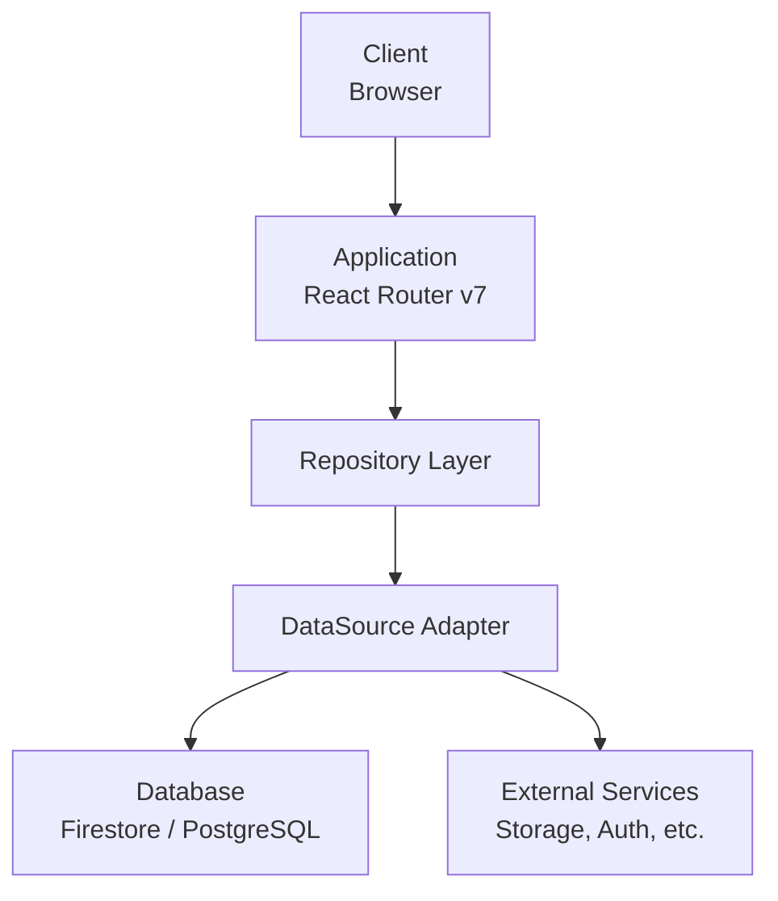

# アーキテクチャ設計思想

## 概要

本テンプレートは、中〜大規模なWebアプリケーション開発のためのモノレポアーキテクチャを提供する。
Google、Microsoft等のグローバル企業が採用するベストプラクティスに基づき、保守性・拡張性・セキュリティを重視した設計を採用している。

## 設計の目標

1. **保守性（Maintainability）**: コードの理解と変更が容易
2. **拡張性（Scalability）**: 機能追加やチーム拡大に対応可能
3. **テスト容易性（Testability）**: 各層が独立してテスト可能
4. **セキュリティ（Security）**: セキュリティバイデザインの実践
5. **パフォーマンス（Performance）**: 効率的なリソース利用

## 設計原則

### 1. 関心の分離（Separation of Concerns）

アプリケーションを以下の層に分離し、各層の責務を明確化する。

```
┌─────────────────────────────────────────────────────────┐
│  Presentation Layer (apps/)                             │
│  - UIコンポーネント、ルーティング、ユーザー操作の処理   │
└────────────────────────┬────────────────────────────────┘
                         │
┌────────────────────────▼────────────────────────────────┐
│  Domain Layer (packages/domains/)                       │
│  - ビジネスロジック、型定義、バリデーションスキーマ     │
└────────────────────────┬────────────────────────────────┘
                         │
┌────────────────────────▼────────────────────────────────┐
│  Data Layer (packages/repositories/)                    │
│  - データアクセス、外部サービス連携                     │
└─────────────────────────────────────────────────────────┘
```

**なぜこの設計か**:
- 各層が独立してテスト可能
- UIフレームワークやデータベースの変更が他の層に影響しにくい
- チーム分割時に責務が明確

### 2. 依存方向の一方向性

依存は常に上位層から下位層へ向かう。下位層は上位層を知らない。

```
apps/ → packages/ui-features/ → packages/ui-core/
                              → packages/domains/
                              → packages/repositories/
                                        ↓
                              packages/domains/
                                        ↓
                              packages/utils/
```

**なぜこの設計か**:
- 循環依存を防止
- 変更の影響範囲を予測可能に
- パッケージの独立性を保証

### 3. 型安全性の徹底

TypeScriptの静的型チェックに加え、Zodによるランタイム検証を組み合わせる。

```typescript
// 型定義（コンパイル時）
type User = {
  id: string
  email: string
  createdAt: Date
}

// スキーマ定義（ランタイム時）
const userSchema = z.object({
  id: z.string().min(1),
  email: z.string().email(),
  createdAt: z.date(),
}) satisfies z.ZodType<User>
```

**なぜこの設計か**:
- 外部データ（API、DB）の不正を実行時に検出
- `satisfies`で型とスキーマの乖離を防止
- バリデーションエラーの詳細な情報を取得可能

### 4. 外部依存の抽象化

データベースや外部サービスへの依存をインターフェースで抽象化する。

```typescript
// 抽象インターフェース
interface DataSource {
  get(path: string): Promise<Document | null>
  set(path: string, data: Record<string, unknown>): Promise<void>
}

// 具体実装（差し替え可能）
class FirestoreAdapter implements DataSource { ... }
class PostgresAdapter implements DataSource { ... }
class MockAdapter implements DataSource { ... }
```

**なぜこの設計か**:
- テスト時にMockAdapterを注入可能
- データベース移行時の影響を最小化
- 実装詳細をドメイン層から隠蔽

## システム構成



## パッケージ構成

```
project/
├── apps/                    # アプリケーション
│   └── web/                 # Webアプリ
├── packages/                # 共有パッケージ
│   ├── config/              # 開発設定
│   ├── domains/             # ドメインモデル
│   ├── repositories/        # データアクセス
│   ├── ui-core/             # 汎用UI
│   ├── ui-features/         # ドメイン固有UI
│   └── utils/               # ユーティリティ
└── scripts/                 # ビルドスクリプト
```

## 技術スタック

| カテゴリ | 技術 | 選定理由 |
|---------|------|----------|
| フレームワーク | React Router v7 | SSR対応、loader/action分離 |
| 言語 | TypeScript | 型安全性 |
| バリデーション | Zod | ランタイム検証、型推論 |
| スタイリング | Tailwind CSS | ユーティリティファースト |
| ビルド | tsup + tsc | 高速バンドル + 正確な型定義 |
| テスト | Vitest | 高速、ESM対応 |
| CI/CD | GitHub Actions | GitHub統合 |

## スケーラビリティ設計

### 水平スケーリング

```
                    ┌─────────────┐
                    │   Load      │
                    │  Balancer   │
                    └──────┬──────┘
           ┌───────────────┼───────────────┐
           ▼               ▼               ▼
    ┌──────────┐    ┌──────────┐    ┌──────────┐
    │  App 1   │    │  App 2   │    │  App N   │
    │ (Stateless)   │ (Stateless)   │ (Stateless)
    └────┬─────┘    └────┬─────┘    └────┬─────┘
         └───────────────┼───────────────┘
                         ▼
              ┌─────────────────────┐
              │   Shared Services   │
              │  (DB, Cache, etc.)  │
              └─────────────────────┘
```

**設計ポイント**:
- アプリケーションはステートレスに設計
- セッション情報は外部ストア（Redis等）で管理
- 環境変数で設定を外部化

### 垂直スケーリング（機能分割）

```
apps/
├── web/           # 顧客向けフロントエンド
├── admin/         # 管理画面
├── api/           # REST/GraphQL API
└── worker/        # バックグラウンドジョブ
```

機能が成長した場合、アプリケーションを分割して独立デプロイ可能。

## フォールトトレランス

### 障害分離パターン

```typescript
// サーキットブレーカーパターンの適用例
class CircuitBreaker {
  private failures = 0
  private lastFailureTime = 0
  private state: 'closed' | 'open' | 'half-open' = 'closed'

  async execute<T>(fn: () => Promise<T>): Promise<T> {
    if (this.state === 'open') {
      if (Date.now() - this.lastFailureTime > this.resetTimeout) {
        this.state = 'half-open'
      } else {
        throw new Error('Circuit is open')
      }
    }

    try {
      const result = await fn()
      this.onSuccess()
      return result
    } catch (error) {
      this.onFailure()
      throw error
    }
  }
}
```

### グレースフルデグラデーション

```typescript
// 外部サービス障害時のフォールバック
async function getRecommendations(userId: string): Promise<Product[]> {
  try {
    return await recommendationService.getForUser(userId)
  } catch (error) {
    // 推薦サービス障害時は人気商品を返す
    logger.warn('Recommendation service failed, falling back to popular items', { error })
    return await productRepository.getPopular({ limit: 10 })
  }
}
```

## クリーンアーキテクチャの原則

### 依存性逆転の原則（DIP）

```
┌─────────────────────────────────────────────────────────┐
│  UI Layer                                               │
│  - React Components                                     │
│  - Hooks                                                │
└────────────────────────┬────────────────────────────────┘
                         │ depends on
┌────────────────────────▼────────────────────────────────┐
│  Application Layer                                      │
│  - Use Cases (loader/action)                           │
│  - Application Services                                 │
└────────────────────────┬────────────────────────────────┘
                         │ depends on
┌────────────────────────▼────────────────────────────────┐
│  Domain Layer                                           │
│  - Entities                                             │
│  - Value Objects                                        │
│  - Domain Services                                      │
│  - Repository Interfaces                                │
└────────────────────────┬────────────────────────────────┘
                         │ implements
┌────────────────────────▼────────────────────────────────┐
│  Infrastructure Layer                                   │
│  - Repository Implementations                           │
│  - External Service Adapters                           │
│  - Database Clients                                     │
└─────────────────────────────────────────────────────────┘
```

### ドメインモデルの豊富化

```typescript
// 貧血ドメインモデル（避けるべき）
type User = {
  id: string
  email: string
  status: 'active' | 'suspended'
}

// リッチドメインモデル（推奨）
class User {
  constructor(
    readonly id: UserId,
    private _email: Email,
    private _status: UserStatus,
  ) {}

  suspend(reason: string): SuspensionEvent {
    if (this._status === 'suspended') {
      throw new DomainError('User is already suspended')
    }
    this._status = 'suspended'
    return new SuspensionEvent(this.id, reason, new Date())
  }

  canAccessResource(resource: Resource): boolean {
    return this._status === 'active' && resource.isAccessibleBy(this)
  }
}
```

## セキュリティアーキテクチャ

### 防御の深層（Defense in Depth）

```
┌─────────────────────────────────────────────────────────┐
│  Layer 1: Network Security                              │
│  - WAF (Web Application Firewall)                       │
│  - DDoS Protection                                      │
│  - TLS/HTTPS Enforcement                                │
└────────────────────────┬────────────────────────────────┘
                         ▼
┌────────────────────────────────────────────────────────┐
│  Layer 2: Application Security                          │
│  - Authentication (JWT/Session)                         │
│  - Authorization (RBAC/ABAC)                           │
│  - Input Validation (Zod)                               │
│  - CSRF Protection                                      │
└────────────────────────┬────────────────────────────────┘
                         ▼
┌────────────────────────────────────────────────────────┐
│  Layer 3: Data Security                                │
│  - Encryption at Rest                                   │
│  - Encryption in Transit                                │
│  - Access Logging                                       │
│  - Data Masking                                         │
└─────────────────────────────────────────────────────────┘
```

詳細は [セキュリティガイドライン](./security.md) を参照。

## 関連ドキュメント

### 基本設計
- [モノレポ構造](./monorepo-structure.md)
- [ビルドシステム](./build-system.md)
- [Repositoryパターン](./repository-pattern.md)
- [技術選定理由](./tech-decisions.md)

### 開発ガイドライン
- [コーディング規約](./coding-standards.md)
- [テスト戦略](./testing-strategy.md)
- [エラーハンドリング](./error-handling.md)
- [ロギング・オブザーバビリティ](./logging-observability.md)

### 運用ガイドライン
- [セキュリティ](./security.md)
- [パフォーマンス](./performance.md)
- [デプロイメント](./deployment.md)
- [環境設定](./environment-configuration.md)

### 開発プロセス
- [Git運用](./git-conventions.md)
- [依存関係管理](./dependency-management.md)
- [API設計](./api-design.md)
- [アクセシビリティ](./accessibility.md)
- [状態管理](./state-management.md)
