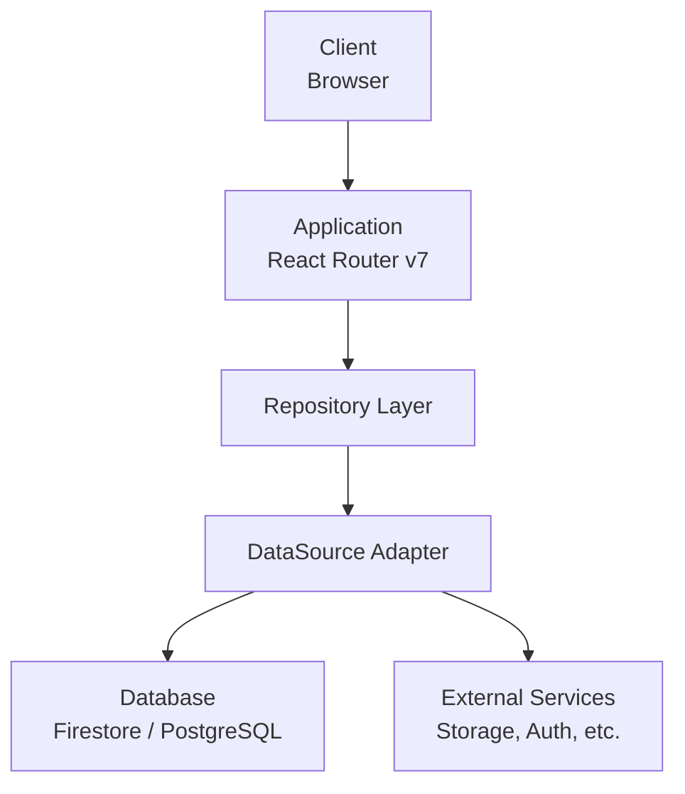

# アーキテクチャ設計思想

## 概要

本テンプレートは、中〜大規模なWebアプリケーション開発のためのモノレポアーキテクチャを提供する。

## 設計原則

### 1. 関心の分離（Separation of Concerns）

アプリケーションを以下の層に分離し、各層の責務を明確化する。

```
┌─────────────────────────────────────────────────────────┐
│  Presentation Layer (apps/)                             │
│  - UIコンポーネント、ルーティング、ユーザー操作の処理   │
└────────────────────────┬────────────────────────────────┘
                         │
┌────────────────────────▼────────────────────────────────┐
│  Domain Layer (packages/domains/)                       │
│  - ビジネスロジック、型定義、バリデーションスキーマ     │
└────────────────────────┬────────────────────────────────┘
                         │
┌────────────────────────▼────────────────────────────────┐
│  Data Layer (packages/repositories/)                    │
│  - データアクセス、外部サービス連携                     │
└─────────────────────────────────────────────────────────┘
```

**なぜこの設計か**:
- 各層が独立してテスト可能
- UIフレームワークやデータベースの変更が他の層に影響しにくい
- チーム分割時に責務が明確

### 2. 依存方向の一方向性

依存は常に上位層から下位層へ向かう。下位層は上位層を知らない。

```
apps/ → packages/ui-features/ → packages/ui-core/
                              → packages/domains/
                              → packages/repositories/
                                        ↓
                              packages/domains/
                                        ↓
                              packages/utils/
```

**なぜこの設計か**:
- 循環依存を防止
- 変更の影響範囲を予測可能に
- パッケージの独立性を保証

### 3. 型安全性の徹底

TypeScriptの静的型チェックに加え、Zodによるランタイム検証を組み合わせる。

```typescript
// 型定義（コンパイル時）
type User = {
  id: string
  email: string
  createdAt: Date
}

// スキーマ定義（ランタイム時）
const userSchema = z.object({
  id: z.string().min(1),
  email: z.string().email(),
  createdAt: z.date(),
}) satisfies z.ZodType<User>
```

**なぜこの設計か**:
- 外部データ（API、DB）の不正を実行時に検出
- `satisfies`で型とスキーマの乖離を防止
- バリデーションエラーの詳細な情報を取得可能

### 4. 外部依存の抽象化

データベースや外部サービスへの依存をインターフェースで抽象化する。

```typescript
// 抽象インターフェース
interface DataSource {
  get(path: string): Promise<Document | null>
  set(path: string, data: Record<string, unknown>): Promise<void>
}

// 具体実装（差し替え可能）
class FirestoreAdapter implements DataSource { ... }
class PostgresAdapter implements DataSource { ... }
class MockAdapter implements DataSource { ... }
```

**なぜこの設計か**:
- テスト時にMockAdapterを注入可能
- データベース移行時の影響を最小化
- 実装詳細をドメイン層から隠蔽

## システム構成



## パッケージ構成

```
project/
├── apps/                    # アプリケーション
│   └── web/                 # Webアプリ
├── packages/                # 共有パッケージ
│   ├── config/              # 開発設定
│   ├── domains/             # ドメインモデル
│   ├── repositories/        # データアクセス
│   ├── ui-core/             # 汎用UI
│   ├── ui-features/         # ドメイン固有UI
│   └── utils/               # ユーティリティ
└── scripts/                 # ビルドスクリプト
```

## 技術スタック

| カテゴリ | 技術 | 選定理由 |
|---------|------|----------|
| フレームワーク | React Router v7 | SSR対応、loader/action分離 |
| 言語 | TypeScript | 型安全性 |
| バリデーション | Zod | ランタイム検証、型推論 |
| スタイリング | Tailwind CSS | ユーティリティファースト |
| ビルド | tsup + tsc | 高速バンドル + 正確な型定義 |
| テスト | Vitest | 高速、ESM対応 |
| CI/CD | GitHub Actions | GitHub統合 |

## 関連ドキュメント

- [モノレポ構造](./monorepo-structure.md)
- [ビルドシステム](./build-system.md)
- [Repositoryパターン](./repository-pattern.md)
- [技術選定理由](./tech-decisions.md)
