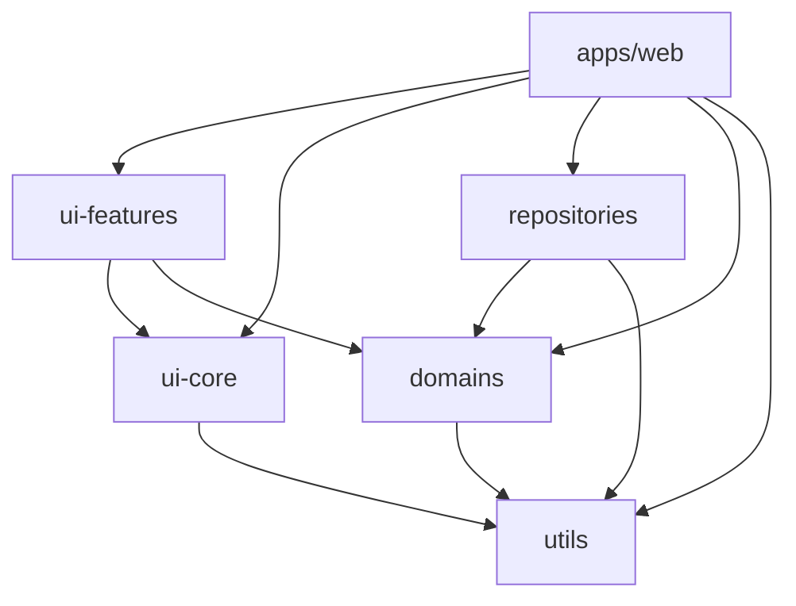

# モノレポ構造

## 概要

npm workspacesを使用したモノレポ構成により、複数のパッケージを単一リポジトリで管理する。

## ディレクトリ構造

```
project/
├── package.json              # ルートpackage.json（workspaces定義）
├── tsconfig.json             # ルートtsconfig（Project References）
├── apps/                     # アプリケーション層
│   ├── web/                  # メインWebアプリ
│   └── admin/                # 管理画面（必要に応じて）
├── packages/                 # 共有パッケージ層
│   ├── config/               # 開発設定
│   ├── domains/              # ドメインモデル
│   ├── repositories/         # データアクセス
│   ├── ui-core/              # 汎用UIコンポーネント
│   ├── ui-features/          # ドメイン固有UIコンポーネント
│   └── utils/                # ユーティリティ関数
├── scripts/                  # ビルド・開発スクリプト
└── docs/                     # ドキュメント
```

## 各パッケージの責務

### apps/

アプリケーション固有のコード。ルーティング、ページコンポーネント、環境設定を含む。

```
apps/web/
├── app/
│   ├── routes/              # ページルーティング
│   ├── components/          # アプリ固有コンポーネント
│   ├── hooks/               # アプリ固有hooks
│   ├── layouts/             # レイアウトコンポーネント
│   ├── server/              # サーバーサイドロジック
│   └── services/            # 外部サービス連携
├── public/                  # 静的ファイル
├── package.json
├── react-router.config.ts
├── tsconfig.json
└── vite.config.ts
```

### packages/config/

開発環境の共通設定を集約。各パッケージはここから設定を継承する。

```
packages/config/
├── tsconfig/
│   ├── base.json            # 基本設定
│   └── build.json           # ビルド用設定
├── eslint/
│   └── base.js              # ESLint基本設定
└── package.json
```

**設計意図**:
- 設定の重複を排除
- 設定変更を一箇所で管理
- 新規パッケージ追加時の設定工数を削減

### packages/domains/

ビジネスロジックとドメインモデルの型定義。外部依存を持たない純粋な層。

```
packages/domains/
├── src/
│   ├── user/
│   │   ├── user.ts          # 型定義
│   │   ├── user.schema.ts   # Zodスキーマ
│   │   └── index.ts         # エクスポート
│   ├── errors/
│   │   └── errors.ts        # ドメインエラー定義
│   └── index.ts
├── package.json
├── tsconfig.json
├── tsconfig.build.json
└── tsup.config.ts
```

**設計意図**:
- UIやデータベースに依存しない
- 単体テストが容易
- 型定義とバリデーションを一箇所に集約

### packages/repositories/

データアクセス層。外部データソースへのアクセスを抽象化する。

```
packages/repositories/
├── src/
│   ├── core/
│   │   ├── types.ts         # DataSource, Document等の型
│   │   └── base-repository.ts
│   ├── adapters/
│   │   ├── firestore-adapter.ts
│   │   └── mock-adapter.ts
│   ├── domain/
│   │   └── users/
│   │       ├── user.repository.ts
│   │       └── user.repository.test.ts
│   ├── factory.ts           # Repository生成ファクトリ
│   └── index.ts
└── ...
```

**設計意図**:
- データソースの差し替えを容易に
- テスト時はMockAdapterを使用
- 各RepositoryがZodでバリデーション

### packages/ui-core/

ドメインに依存しない汎用UIコンポーネント。

```
packages/ui-core/
├── src/
│   ├── components/
│   │   ├── button/
│   │   │   ├── button.tsx
│   │   │   └── index.ts
│   │   ├── dialog/
│   │   └── ...
│   ├── hooks/
│   ├── styles/
│   │   ├── global.css
│   │   └── reset.css
│   └── index.ts
└── ...
```

**設計意図**:
- プロジェクト間で再利用可能
- Tailwind CSS + CVAでスタイリング
- アクセシビリティを考慮した実装

### packages/ui-features/

ドメイン固有のUIコンポーネント。domainsパッケージの型に依存する。

```
packages/ui-features/
├── src/
│   ├── user/
│   │   ├── components/
│   │   │   └── user-card/
│   │   └── index.ts
│   └── index.ts
└── ...
```

**設計意図**:
- ドメインモデルを理解したコンポーネント
- アプリ間で共通のUI/UXを提供

### packages/utils/

汎用ユーティリティ関数。他のパッケージに依存しない。

```
packages/utils/
├── src/
│   ├── date/
│   │   ├── date-utils.ts
│   │   └── date-utils.test.ts
│   ├── string/
│   └── index.ts
└── ...
```

**設計意図**:
- 純粋関数のみで構成
- 外部依存は最小限（date-fns等）
- 徹底的なテスト

## 依存関係



## package.json設定

### ルートpackage.json

```json
{
  "name": "my-project",
  "workspaces": [
    "apps/*",
    "packages/*"
  ],
  "scripts": {
    "dev": "node --experimental-strip-types scripts/dev.mts",
    "build": "node --experimental-strip-types scripts/build.mts",
    "typecheck": "tsc -b",
    "lint": "eslint .",
    "test": "vitest run"
  }
}
```

### 各パッケージのpackage.json

```json
{
  "name": "@project/domains",
  "private": true,
  "type": "module",
  "main": "dist/index.cjs",
  "module": "dist/index.js",
  "types": "dist/index.d.ts",
  "exports": {
    ".": {
      "types": "./dist/index.d.ts",
      "import": "./dist/index.js",
      "require": "./dist/index.cjs"
    }
  },
  "scripts": {
    "build": "npm run build:types && npm run build:js",
    "build:types": "tsc --project tsconfig.build.json",
    "build:js": "tsup"
  },
  "dependencies": {
    "@project/utils": "*"
  }
}
```

## ワークスペース間の参照

パッケージ間の依存は`*`で指定し、常にローカルのパッケージを参照する。

```json
{
  "dependencies": {
    "@project/domains": "*",
    "@project/utils": "*"
  }
}
```

## 関連ドキュメント

- [ビルドシステム](./build-system.md) - パッケージのビルド順序と設定
- [アーキテクチャ](./architecture.md) - 全体設計思想
